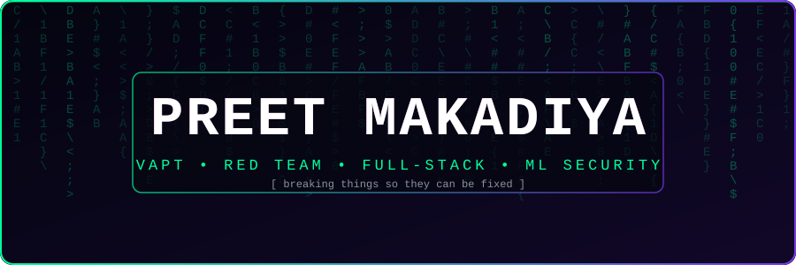
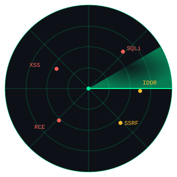
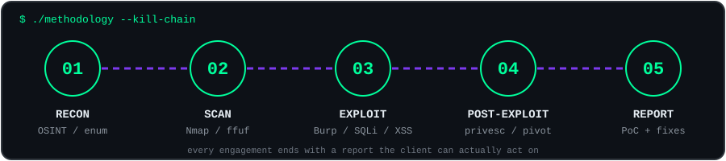

<div align="center">





<br/>


<br/><br/>


<br/>

<a href="https://preetversex.netlify.app"></a>
<a href="https://linkedin.com/in/preet-makadiya-13102004-p/"></a>
<a href="https://instagram.com/preet_1310_"></a>
<a href="mailto:makadiyapreeta1@gmail.com"></a>

<a href="https://github.com/makadiyapreet">
  
</a>


</div>

## 🎯 `> threat_model --me`

<table>
<tr>
<td width="360" align="center"></td>
<td valign="top">

```python
class Preet:
    role        = "Cybersecurity student | VAPT & Red Team"
    university  = "PDEU, Gandhinagar (B.Tech CSE)"
    wins        = ["GATE CS 2026", "National hackathon", "VP, Society of Mathematics"]
    attack      = ["Web apps", "REST APIs", "Auth & session flaws"]
    defend      = ["ML-based WAF", "Honeypots", "Threat intel / OSINT"]
    learning    = ["Advanced pentesting", "Deep learning", "Cloud security"]
    open_to     = ["Internships", "CTF teams", "Open-source security"]

    def motto(self):
        return "Think like an attacker. Build like a defender."
```

</td>
</tr>
</table>

<div align="center"></div>

## ⚔️ `> ./methodology --kill-chain`

<div align="center"></div>

<div align="center"></div>

## 📡 `> nmap -sV preetversex`

<div align="center"></div>

<div align="center"></div>

## 🛠️ `> ls ~/projects`

<div align="center">
<a href="https://github.com/makadiyapreet/AEGIS"></a>
<a href="https://github.com/makadiyapreet/NETRA"></a>
<br/>
<a href="https://github.com/makadiyapreet/SentinelAI"></a>
<a href="https://github.com/makadiyapreet/RedForge"></a>
</div>

| Project | What it does |
|---|---|
| 🛡️ **AEGIS** | Unified honeypot, logging and sandboxing platform to trap and analyse attackers |
| 👁️ **NETRA** | Multilingual OSINT and cyber threat intelligence platform (hackathon build) |
| 🧠 **SentinelAI** | ML-powered Web Application Firewall that blocks SQLi, XSS and more |
| ⚔️ **RedForge** | Automated web app exploitation and pentest report framework |

<div align="center"></div>

## 📊 `> ./skills --level`

<div align="center">



<br/><br/>

**Security Toolbelt**


</div>

<details>
<summary><b>💻 Full tech stack (click to expand)</b></summary>
<br/>
<div align="center">

<br/>
<br/>
<br/>


</div>
</details>

<div align="center"></div>

## 📈 `> git log --stats`

<div align="center">


</div>

<div align="center"></div>

## 🐍 `> ./snake.sh`

<div align="center">
<picture>
  <source media="(prefers-color-scheme: dark)" srcset="https://raw.githubusercontent.com/makadiyapreet/makadiyapreet/output/github-snake-dark.svg" />
  <source media="(prefers-color-scheme: light)" srcset="https://raw.githubusercontent.com/makadiyapreet/makadiyapreet/output/github-snake.svg" />
  
</picture>
</div>

<div align="center"></div>

## 🏆 `> cat achievements.log`

| | |
|---|---|
| 🏆 | National hackathon winner |
| 🎓 | GATE CS 2026 qualified |
| 📐 | Vice President, Society of Mathematics, PDEU |
| 🔴 | Red Team assessment and VAPT internships |
| 🛠️ | Built a WAF, honeypot, OSINT and exploitation tooling from scratch |

## 🤝 `> ping collaboration`

> Open to **cybersecurity internships**, **open-source security projects** and **CTF teams**.
> Ask me about **VAPT, WAFs, honeypots, SIEM, OWASP Top 10, Django, FastAPI, API security**.

<div align="center">


</div>
